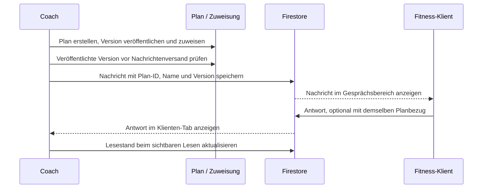

# Coach ↔ Klient: Kommunikation

Stand: 2026-11-01. Technischer und fachlicher Einstieg für den Gesprächsbereich.
Betrieb, Testbefehle, Freigabe und Fehlerbilder stehen im
[Runbook](COACH-COMMUNICATION-RUNBOOK.md).

## Implementierungs- und Veröffentlichungsstand

| Bestandteil | Nachgewiesener Stand |
| --- | --- |
| Coach: Nachrichten-Tab, Composer, Planbezug | Implementiert, lokal gebaut und im Emulator-Browser geprüft |
| Fitness: persönlicher Gesprächsbereich | Implementiert; ersetzt die statische Inbox-Roadmap |
| Firestore-Zugriffsregeln | Auf separatem VitalOS-Feature-Branch vorbereitet und im Emulator geprüft |
| Authentifizierung auf echten Geräten | Noch separat abzunehmen |
| Produktive Rules/Hosting-Veröffentlichung dieses Features | In dieser Arbeit nicht ausgeführt |
| Push, Anhänge, globale Unread-Zähler | Noch nicht implementiert |

Implementierungsstände: Coach `d9a005e`, Fitness `4544698`, VitalOS-Regeln
`2421611` auf `codex/coach-communication`. Diese Referenzen bezeichnen die
Implementierung; spätere Dokumentationscommits ändern den Nachweis nicht.
Ein lokaler Build oder Commit belegt keinen veröffentlichten App-/Regelstand.

## Zuständigkeiten und Grenzen

| Owner | Verantwortung / Einstieg |
| --- | --- |
| Coach (`~/dev/coach-dev`) | Klientenauswahl, Coach-Oberfläche, expliziter Zielklient, Coach-Adapter |
| Fitness (`~/dev/fitness-dev`) | Klienten-Inbox, Cloud-Auth, eigener UID-Pfad, Klienten-Adapter |
| VitalOS | Projektweite Firestore-Regeln, Regeltests und deren Veröffentlichung |
| Plan (`~/dev/plan-dev`) | Planeditor, veröffentlichte Versionen und Zuweisung; Coach nutzt seinen Pin |
| Firestore | Gemeinsamer Nachrichtenverlauf und Lesestände |

Die Regeln werden im Worktree `~/dev/.worktrees/vitalos-coach-communication`
vorbereitet. Der stabile Checkout `~/vitalos` bleibt Produktions-/Integrationsstand.
Coach ist kein VitalOS-App-Submodul. Sein eigener `vitalos/`-Pin wird durch diese
Nachrichtenimplementierung nicht angehoben. Plan benötigt dafür keinen Pointer-Bump.

Nachrichten benutzen weder `coach-sync.service` noch `coachCommands`, den lokalen
Gateway auf 9150 oder den Fitness-Upstream auf 8100. Der Laptop muss für diesen
Austausch nicht eingeschaltet sein. Klienten-Registry, lokale Trainingspläne,
Session-Logs und Katalog-YAMLs werden nicht als weiterer Nachrichtenspeicher benutzt.

## Bedienung

### Coach

1. Klienten in Coach auswählen und den Detail-Tab **Nachrichten** öffnen.
   Der direkte Hash ist `#/clients/<clientUid>/messages` innerhalb `coach.html`.
2. Unter **Bezug** eine allgemeine Nachricht oder einen veröffentlichten Plan wählen.
3. Nachricht schreiben und **Nachricht senden** betätigen.
4. Auf bestätigte Speicherung bzw. sichtbare Fehlermeldung achten.

Ein Planbezug ist nur für gelistete Pläne mit `headVersion > 0` wählbar. Direkt
vor dem Versand lädt Coach den Plan erneut: `published` muss vorhanden sein und
die ausgewählte Versionsnummer muss noch `headVersion` entsprechen. Sonst bleibt
der Text erhalten und die Oberfläche fordert zum erneuten Öffnen/Prüfen auf.
Der gespeicherte Name stammt aus dem veröffentlichten Snapshot.

### Klient

1. Mit dem eigenen Cloud-Konto in Fitness anmelden; **Inbox/Nachrichten** öffnen.
2. Coach-Nachricht und gegebenenfalls Planname/Versionsnummer lesen.
3. **Zu diesem Plan antworten** übernimmt den Bezug in den Composer.
4. **Bezug entfernen** wechselt zur allgemeinen Nachricht. Antwort senden.

Der Klient übergibt keine frei wählbare Ziel-UID. Der Adapter ermittelt sie aus
Firebase Auth. Ein nicht angemeldeter Nutzer sieht einen Anmeldehinweis.

### Zusammenhang mit der Planbereitstellung



Die Nachricht ist keine Planfreigabe oder Zustellung einer Plankopie. Der Plan
muss über den bestehenden Plan-Workflow bereitgestellt werden. Ein älterer
Nachrichtenbezug bleibt historisch auf seine Version bezogen und folgt keiner
späteren Planbearbeitung. Es gibt aktuell keinen direkten Plan-Öffnen-Link in
der Nachricht. Die Klienten-Antwort übernimmt einen bestehenden Bezug; sie
veröffentlicht keine neue Version und prüft nicht erneut den aktuellen Plan-Head.

## Datenvertrag

Die Collection liegt außerhalb der älteren breiten `fitness/{uid}`-Owner-Regeln:

```text
coachConversations/{clientUid}/
  messages/{messageId}
  readStates/{readerUid}
```

Der übergeordnete Conversation-Datensatz wird nicht zusätzlich angelegt.
Abos laufen direkt auf den beiden Subcollections.

### Nachricht

| Feld | Typ / Vorgabe | Herkunft |
| --- | --- | --- |
| `body` | String, 1–4000 Zeichen | UI/Adapter trimmt Rand-Leerzeichen |
| `senderUid` | String, muss Auth-UID entsprechen | Auth-Kontext des jeweiligen Adapters |
| `senderRole` | `coach` oder `client` | Adapter setzt Rolle; Regeln prüfen Berechtigung |
| `createdAt` | Firestore Timestamp, beim Erstellen gleich `request.time` | `serverTimestamp()` |
| `plan` | `null` oder exakt `{id,name,version}` | Allgemein bzw. ausgewählter/historischer Bezug |

Alle fünf Felder sind erforderlich; weitere Felder lehnen die Regeln ab.
Nachrichten-IDs sind automatisch erzeugte Dokument-IDs. Die Regel erlaubt
`[A-Za-z0-9_-]` mit 1–128 Zeichen. `plan.id` hat 1–128 Zeichen, `plan.name`
1–200 Zeichen, `plan.version` ist eine positive Ganzzahl.

Beispielinhalt; Zeitstempel sind echte Firestore-Werte, keine ISO-Strings:

```js
{
  body: 'Bitte prüfe die Pausen im neuen Plan.',
  senderUid: '<angemeldeter-coach>',
  senderRole: 'coach',
  createdAt: serverTimestamp(),
  plan: { id: '<plan-id>', name: '3er-Split', version: 2 }
}
```

Die Regeln prüfen beim Planbezug die Struktur, **nicht** die Existenz oder
Freigabe des referenzierten Plans. Die Coach-UI übernimmt die Versionsprüfung.
Ein Nachrichtenbezug ist deshalb kein serverseitiger Nachweis der Planfreigabe.

### Lesestand

`readStates/{readerUid}` enthält ausschließlich `{lastReadAt: serverTimestamp()}`.
Nur der angemeldete Leser schreibt sein eigenes Dokument. Andere Teilnehmer
dürfen es lesen. Das Feld wird beim sichtbaren Gespräch aktualisiert, wenn die
neueste fremde Nachricht über `IntersectionObserver` im Sichtbereich liegt und
das Dokument sichtbar ist. Es ist ein zeitbasierter Lesestand, keine einzelne
Empfangsbestätigung pro Nachricht.

Coach vergleicht eigene Nachrichten mit dem Lesestand genau dieses Klienten.
Die Klienten-Ansicht verwendet den neuesten Lesestand eines anderen Teilnehmers:
**Vom Coach gesehen** bedeutet damit bei mehreren Coaches mindestens ein Coach,
nicht zwingend ein bestimmter zugewiesener Coach. Es ist kein Nachweis, dass ein
Text vollständig gelesen oder eine Push-Benachrichtigung empfangen wurde.

## Rollen und Zugriffsmodell

| Akteur | Lesen | Nachricht erstellen | Lesestand schreiben |
| --- | --- | --- | --- |
| Klient mit eigener Auth-UID | Eigener Gesprächspfad | Eigene UID, Rolle `client` | Eigene Leser-ID |
| Coach gemäß zentraler `isCoach()`-Regel | Alle Klientengespräche im Projekt | Eigene UID, Rolle `coach` | Eigene Leser-ID im geöffneten Gespräch |
| Anderer Klient | Kein fremder Pfad | Nicht in fremden Pfaden | Kein fremder Lesestand |
| Nicht angemeldet | Nein | Nein | Nein |

`isCoach()` ist die vorhandene zentrale Rollenprüfung (Coach-Claim, Rollen-Dokument
oder bestehender Legacy-UID-Fallback). Es gibt aktuell keine Zuordnung, die einen
Coach ausschließlich auf seine eigenen Klienten beschränkt. Eine spätere
Mehrtrainer-/Mandantenlösung benötigt ein eigenes Berechtigungskonzept.

Browser-Clients dürfen bestehende Nachrichten weder ändern noch löschen. Die
Regeln schützen nicht gegen privilegierte Admin-SDK-Zugriffe: Wartung und Exporte
bleiben deren eigener Verantwortungsbereich. Die UI bietet keine Bearbeitung,
Löschung, automatische Aufbewahrungsfrist oder Suchfunktion für Nachrichten.

## Live-Abos, Entwürfe und Netzverhalten

Beide Adapter abonnieren `createdAt desc`, `limit(100)` und stellen die Ergebnisse
in der Oberfläche chronologisch dar. Lesestände haben ein separates Live-Abo.
Beim Verlassen werden beide Abos beendet. Coach bindet die Komponente per Key an
die gewählte UID; Fitness remountet sie bei einem Auth-Kontowechsel.

| Anzeige/Zustand | Bedeutung und Grenze |
| --- | --- |
| `Wird gesendet…` | Write steht aus; noch keine bestätigte Speicherung |
| `Gespeichert` | Firestore hat den Write bestätigt; keine Push-Garantie |
| `Vom Klienten/Coach gesehen` | Lesestand der Gegenseite liegt zeitlich nach der Nachricht |
| `Lokaler Stand · Verbindung wird abgeglichen` | Snapshot stammt aus Cache; das allein beweist keinen Offline-Zustand |
| Fehler | Text bleibt im aktuellen Composer erhalten; Fehler prüfen |

Entwürfe sind React-State: während eines Fehlers erhalten, aber nicht dauerhaft
auf Festplatte gespeichert. Klientenwechsel, Kontowechsel, Unmount oder Reload
verwerfen sie. Genau diese Trennung verhindert Entwurfsübernahme zum falschen
Klienten. Keine garantierte Offline-Warteschlange über App-Neustarts behaupten;
Cache-/Pending-Verhalten hängt auch von der vorhandenen Firebase-Initialisierung ab.
Ein erneuter Sendeaufruf erhält eine neue Dokument-ID; bei unklarem Ausgang erst
den Verlauf prüfen, statt eine exakt-einmalige Zustellung vorauszusetzen.

## Quellcode und Abgrenzung zu bestehenden Werkzeugen

| Datei | Verantwortung |
| --- | --- |
| `src/views/Coach/ClientMessages.jsx` | Coach-Verlauf, Composer, Planprüfung, Lesestand |
| `src/lib/db/firestore/communication.js` | Coach-Adapter mit expliziter Klienten-UID |
| `src/views/Coach/ClientsPanel.jsx` | Klientenauswahl und gekeyter Nachrichten-Tab |
| `src/views/Coach/coachRoute.js` | Persistenter Hash `messages` |
| `fitness-dev/src/views/Inbox/Inbox.jsx` | Auth-Gate der Klienten-Inbox |
| `fitness-dev/src/views/Inbox/CoachConversation.jsx` | Klienten-Verlauf/Antworten/Lesestand |
| `fitness-dev/src/lib/coachConversation.js` | Auf eigene Auth-UID begrenzter Adapter |
| VitalOS `firestore.rules` | Zugriffs- und Schema-Regeln |

Bestehende Session-, Workout- oder Journal-Kommentare (`coachFeedback`) bleiben
kontextbezogene Felder. Sie werden nicht automatisch in den Gesprächsverlauf
migriert. Die Coach-Kommentar-Erfolgsmeldung behauptet keinen ungeprüften
Push-Versand mehr. Katalog-Inbox, Enrichment und `coach notifications` sind andere
Funktionen; neue Nachrichten gehören nicht in deren Queues oder Katalog-YAMLs.

## Nachweise und nächste Ausbaustufen

Geprüft wurden fünf Rules-Testfälle, Coach-Hash-Routing, zwei Plan-Vertragstests,
ESLint, beide Firebase-App-Builds und ein mobiler Browserablauf mit echten Adaptern
gegen den lokalen Emulator. Details, Befehle und Abnahmeprotokoll im
[Runbook](COACH-COMMUNICATION-RUNBOOK.md). Die Browser-Fixture testet UI/Protokoll
mit Emulator-Identitäten, nicht den echten Login, Claims-Provisionierung oder
Push auf einem iPhone. Die Dokumentation ersetzt keine Cloud-/Geräteabnahme.

| Ausbaustufe | Aktueller Umfang / nächster Schritt |
| --- | --- |
| Historie | Letzte 100; Pagination/ältere Nachrichten fehlen |
| Entwürfe | Nur lokaler Komponenten-State; sichere persistente Entwürfe fehlen |
| Unread | Lesestände vorhanden; globale Zähler/Badges fehlen |
| Push | Kein neuer Nachrichten-Trigger implementiert |
| Anhänge | Kein Upload oder Medienvertrag |
| Plan-Navigation | Referenz wird angezeigt; direkter Plan-Link fehlt |
| Mehrtrainer | Projektweite Coach-Rolle; keine Klientenzuweisungs-ACL |
| Bearbeiten/Löschen | Durch Client-Regeln gesperrt; kein eigener Produktablauf |
| Echte Geräte | Nach autorisiertem Rules- und App-Release abzunehmen |

## Aktuelle Priorität: Rückmeldung direkt am Trainingsplan

Der gemeinsame PlanFeedback-Bereich erscheint unter „Trainingspläne → Plan ansehen“ sowie im individuellen Plan. Er bestätigt den Empfang einer festen Version und sammelt Fragen und Coach-Antworten genau dazu. Vertrag und Bedienung: [Plan-Feedback](../modules/plan/docs/PLAN-FEEDBACK.md). Freier Chat-Ausbau ist zurückgestellt. Die bisherigen Gesprächsfunktionen sind nicht der Versandmechanismus für Trainingspläne. Neue Plan-Regeln sind noch nicht deployed.
